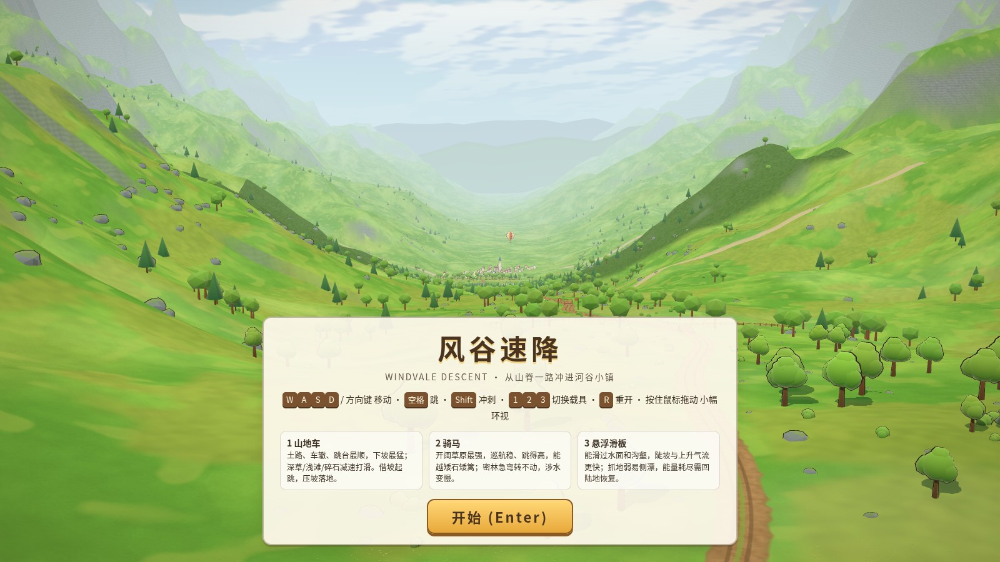
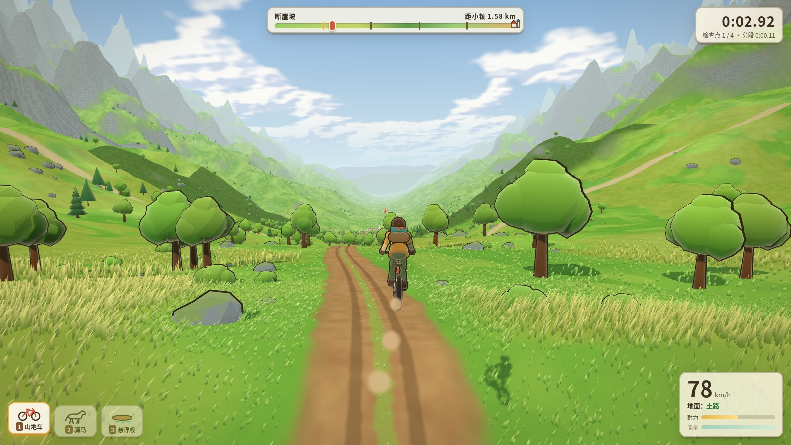
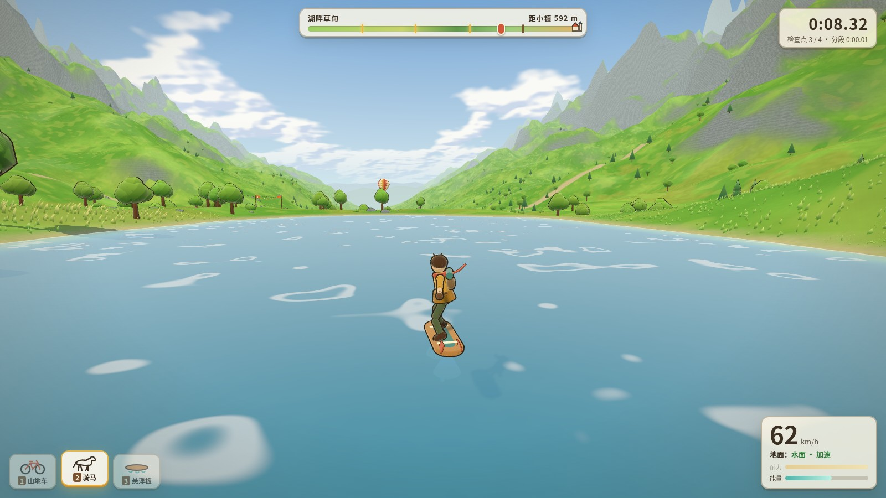
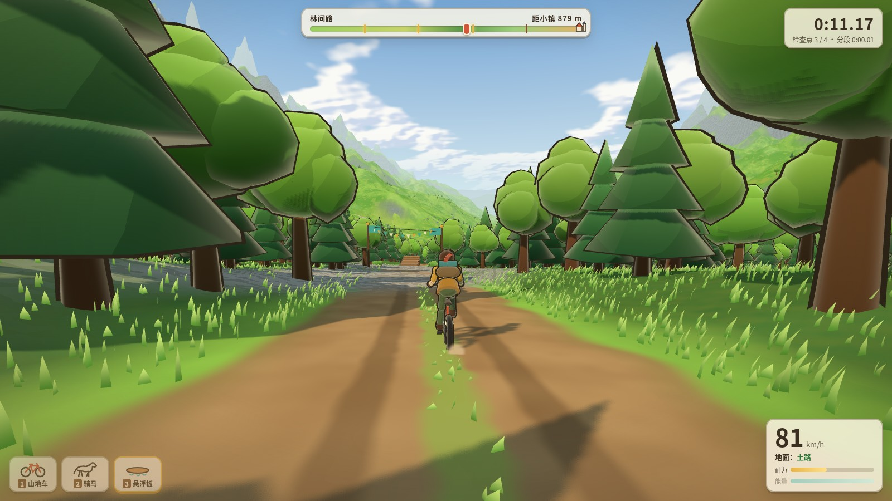
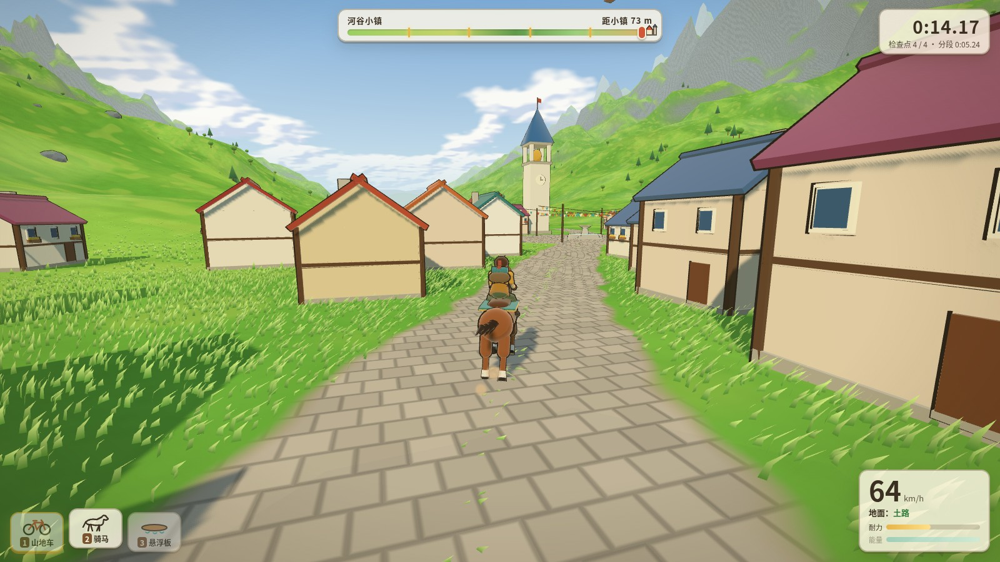

# 风谷速降 / Windvale Descent

一款第三人称下山竞速小游戏，全部内容写在单个 `index.html` 里，用 Three.js 在浏览器中运行。场景、载具、材质和音效都是程序生成的，不依赖外部模型或贴图。

## 截图

## 怎么玩

需要能访问网络，因为 Three.js 是从 jsDelivr CDN 加载的。任选一种方式打开：

- 用浏览器直接打开 `index.html`
- 或在本目录运行 `python3 -m http.server`，再访问 http://localhost:8000

进入后点击「开始」，或在电脑上按 Enter。

## 操作

**电脑：** WASD / 方向键移动，空格跳跃，Shift 冲刺，1 / 2 / 3 切换载具（自行车 / 马 / 悬浮板），R 重开，鼠标环视。触摸按钮在桌面端会隐藏。

**手机 / 平板：** 打开后会自动显示触摸控件。左侧虚拟摇杆移动，右侧滑动环视，右侧按钮跳跃 / 冲刺 / 重开，点图标切换载具。建议横屏游玩。

三种载具路感不同：自行车擅长道路和下坡，马在草地更稳，悬浮板可以越水但能量有限。到达谷底小镇即完赛，可查看成绩并再来一局。

## How to play (English)

A self-contained third-person downhill racer. Open `index.html` in a browser, or serve this folder with `python3 -m http.server` and visit http://localhost:8000. A network connection is required for the Three.js CDN.

On desktop, use WASD or arrow keys, Space to jump, Shift to boost, 1 / 2 / 3 to switch vehicles (bike / horse / hoverboard), R to restart, and the mouse to look around. On a phone or tablet, on-screen controls appear automatically: left stick to move, right side to look, jump / boost / restart buttons, and vehicle icons. Landscape is recommended.

No build step or bundler is needed.
